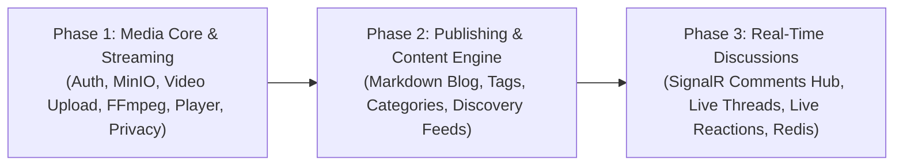
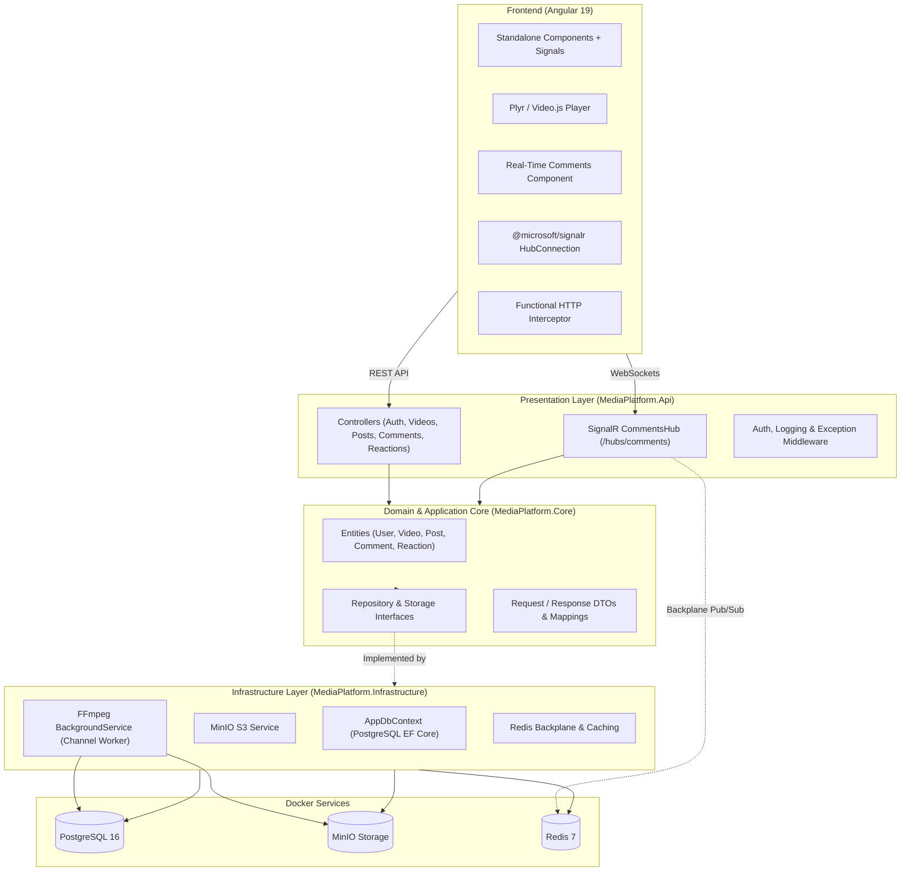
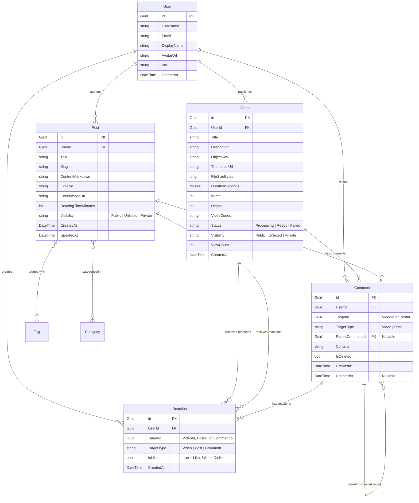
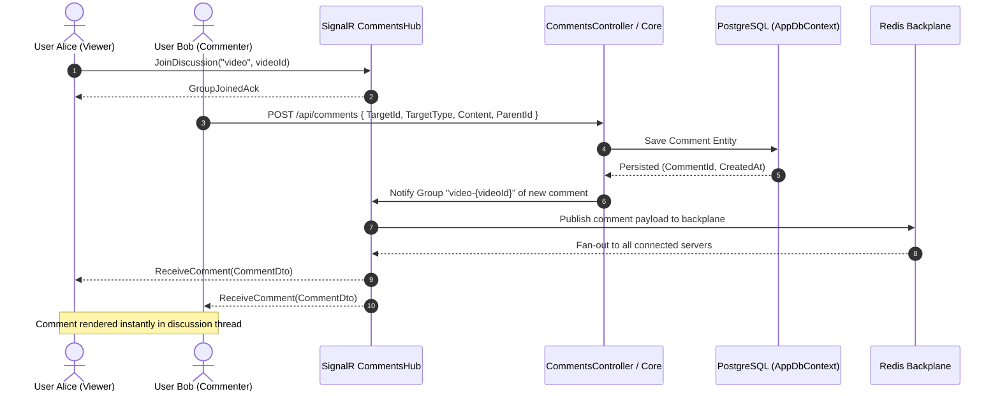

# Product Requirements Document (PRD) — MediaPlatform

**Document Status:** Ready for Implementation  
**Target Audience:** Junior Developers, Full-Stack Engineers, QA  
**Version:** 1.1.0  
**Last Updated:** November 2026  
**File Location:** `/tasks/prd-media-platform.md`

---

## 1. Introduction & Overview

### 1.1 Product Overview
**MediaPlatform** is an all-in-one content platform combining video hosting, rich-text blogging, social interactions, and a **real-time comment and reaction system**. Built as a monorepo using **.NET 10** (ASP.NET Core Web API) and **Angular 19**, the platform provides creators and users with a unified space to publish articles, stream videos, and engage in live, low-latency discussions.

### 1.2 Problem Statement
Content platforms often suffer from delayed social interactions: users must refresh the page to see new replies, reactions lag behind, and discussion threads feel static. Furthermore, creators often have to juggle disparate tools for video and written articles. 

MediaPlatform solves this by uniting video streaming, rich-text markdown blogging, and a **live-updating real-time discussion engine** where viewers see comments, replies, and reactions arrive instantaneously as they watch videos or read articles.

### 1.3 Core Goal
Deliver a scalable, decoupled full-stack platform featuring:
* Video upload with asynchronous FFmpeg background processing (metadata extraction and thumbnail generation).
* HTTP 206 Partial Content video streaming (Plyr / Video.js).
* Markdown blog engine with inline media uploads and tag/category filtering.
* Granular content visibility (**Public**, **Unlisted**, **Private**).
* **Real-time threaded comments and live reactions** powered by ASP.NET Core SignalR and Redis.

---

## 2. Goals & Delivery Roadmap

### 2.1 Primary Objectives
1. **Clean Architecture Backend:** Strict decoupling across Domain Core, Infrastructure, and Presentation API layers, backed by PostgreSQL, MinIO (S3-compatible object storage), and Redis.
2. **Resilient Video Pipeline:** Ingest video files, offload heavy operations (metadata probing, thumbnail snapshot generation) to a non-blocking background worker (`Channel<T>`), and stream via HTTP 206 Range Requests.
3. **Flexible Publishing Engine:** Markdown creation with media embeds, automatic SEO slug generation, tagging, categorisation, and privacy controls.
4. **Real-Time Community Engagement:** Instantaneous live comment streams and reaction synchronization using SignalR group rooms with a Redis backplane.

### 2.2 Phased Delivery Roadmap

* **Phase 1 (Milestone 1 — Media Core & Streaming):** Identity & JWT Token Refresh, MinIO Object Storage, Video Upload pipeline, FFmpeg Background Worker (thumbnails + metadata), HTTP 206 video streaming, Plyr/Video.js integration, and Visibility controls (Public/Unlisted/Private).
* **Phase 2 (Milestone 2 — Publishing & Discovery Engine):** Markdown blog editor with live preview, inline image uploads to MinIO, tag and category taxonomy, paginated content discovery feeds, and search filtering.
* **Phase 3 (Milestone 3 — Real-Time Discussions & Reactions):** SignalR Comments Hub (`/hubs/comments`) with Redis backplane, group-based subscriptions per video/post, live nested comment stream (create, reply, edit, soft-delete), and synchronized live reaction counters.

---

## 3. User Stories

### 3.1 Unauthenticated Visitor (Guest)
* **US-1.1:** As a guest, I want to watch public videos and read public blog posts without logging in so I can explore content freely.
* **US-1.2:** As a guest, I want to view unlisted videos and articles when given a direct URL or slug, while knowing they do not appear in public feeds.
* **US-1.3:** As a guest, I want to observe the real-time comment section and see new comments and reaction count changes appear live without refreshing the page.
* **US-1.4:** As a guest, I want to see clear prompts to log in or register whenever I attempt to post a comment or react to content.

### 3.2 Registered User & Creator
* **US-2.1:** As a creator, I want to register and log in securely, receiving an access token and refresh token, so that I maintain continuous authenticated sessions.
* **US-2.2:** As a creator, I want to update my profile with an avatar, display name, and bio to personalize my presence.
* **US-2.3:** As a creator, I want to upload videos (MP4, WebM) with title, description, and visibility, receiving immediate confirmation while FFmpeg extracts metadata and generates a thumbnail in the background.
* **US-2.4:** As a creator, I want to set the visibility of my media and posts to **Public**, **Unlisted**, or **Private** (author draft).
* **US-2.5:** As an author, I want to write blog articles using a Markdown editor with live preview and upload inline images directly to MinIO.
* **US-2.6:** As a creator, I want to edit or delete my own videos and blog articles at any time.

### 3.3 Engaged Community Member
* **US-3.1:** As a user, I want to post top-level comments on videos and blog posts and have them appear immediately for all active viewers.
* **US-3.2:** As a user, I want to reply directly to an existing comment (nested thread) and see the conversation branch visually.
* **US-3.3:** As a user, I want to edit or delete my own comments. If a deleted comment has child replies, it should display a `[Comment deleted]` placeholder so the conversation flow is preserved.
* **US-3.4:** As a user, I want to toggle like or dislike on posts, videos, and comments with instant visual feedback (optimistic update), while other connected viewers see the updated count in real time.

---

## 4. Functional Requirements

### 4.1 Authentication & User Management (Auth Module)
* **FR-1.1:** The system must allow users to register with `Email`, `UserName`, `DisplayName`, and `Password` using ASP.NET Core Identity.
* **FR-1.2:** The system must issue a short-lived JWT Access Token (15 minutes) and a persistent cryptographically secure Refresh Token (7 days) upon successful authentication.
* **FR-1.3:** The system must provide a token refresh endpoint (`POST /api/auth/refresh`) that validates the refresh token, rotates it, and issues a new JWT access token without requiring re-login.
* **FR-1.4:** The system must allow authenticated users to update their profile (`DisplayName`, `Bio`, and upload an `Avatar` image to MinIO).
* **FR-1.5:** The system must enforce authorization checks: users can only modify/delete their own resources; platform administrators can moderate any content.

### 4.2 Video Hosting & Media Processing Pipeline
* **FR-2.1:** The system must support video uploads in standard web formats (`video/mp4`, `video/webm`, `video/quicktime`) up to 500MB.
* **FR-2.2:** Video uploads must be written directly to a private MinIO S3 bucket under the key format: `videos/{userId}/{videoId}/{originalFileName}`.
* **FR-2.3:** The API must accept the upload, persist a `Video` entity in PostgreSQL with status `Processing`, and enqueue a job to a background channel before returning HTTP 202 Accepted.
* **FR-2.4:** An asynchronous background worker (`IHostedService` / `BackgroundService`) consuming from `System.Threading.Channels.Channel<VideoProcessingJob>` must handle processing without blocking the HTTP request thread.
* **FR-2.5:** The background worker must invoke FFmpeg to:
  1. Probe the video stream to extract duration (seconds), width, height, video codec, and audio codec.
  2. Extract a thumbnail snapshot frame at 10% into the video duration (or at 2.0 seconds) and save it as a JPEG image.
  3. Upload the generated thumbnail to MinIO under `thumbnails/{userId}/{videoId}.jpg`.
  4. Update the `Video` record in PostgreSQL with metadata, thumbnail URL, and set status to `Ready` (or `Failed` with error details if probing/snapshot fails).
* **FR-2.6:** The API must provide an HTTP 206 Partial Content streaming endpoint (`GET /api/videos/{id}/stream`) supporting `Range: bytes=start-end` request headers for smooth seeking in Plyr / Video.js.
* **FR-2.7:** Creators must be able to update video metadata (Title, Description, Tags, Category, Visibility) and delete their videos (purging both database records and MinIO storage objects).

### 4.3 Content Privacy & Visibility Rules
* **FR-3.1:** Every video and blog post must have an explicit visibility state:
  * `Public`: Discoverable in public feeds, category filters, and search queries.
  * `Unlisted`: Accessible only via direct URL or slug; excluded from public listings and search.
  * `Private`: Accessible exclusively by the author and platform admins.
* **FR-3.2:** Viewing an `Unlisted` resource requires the specific ID or slug, but does not require authentication.
* **FR-3.3:** Unauthenticated requests or requests from unauthorized users for `Private` resources must return HTTP 404 Not Found (or HTTP 403 Forbidden).

### 4.4 Blogging Engine
* **FR-4.1:** The system must support creating and editing blog articles formatted in Markdown with code highlighting, quotes, headings, and tables.
* **FR-4.2:** The blog editor must provide an inline image uploader that saves images to MinIO (`posts/images/{userId}/{imageId}.ext`) and inserts markdown image syntax `` at the cursor position.
* **FR-4.3:** Each article must generate a unique, SEO-friendly slug derived from the title (e.g., `my-first-post-a1b2c3d4`).
* **FR-4.4:** Articles must support classification via Categories and Tags.
* **FR-4.5:** The API must provide paginated article feeds (`GET /api/posts?page=1&pageSize=10&tag=...&category=...&search=...`).
* **FR-4.6:** The system must compute and display an estimated reading time based on word count (~200 words per minute).

### 4.5 Real-Time Threaded Comment Section & Live Reactions
* **FR-5.1:** The system must provide a SignalR Hub (`/hubs/comments`) that allows clients to join discussion groups keyed by target content: `JoinDiscussion(string targetType, Guid targetId)` (e.g., `video-{id}` or `post-{id}`).
* **FR-5.2:** Clients must be able to leave groups via `LeaveDiscussion(string targetType, Guid targetId)` or automatically upon WebSocket disconnect.
* **FR-5.3:** The system must support nested/threaded comments on both videos (`TargetType = Video`) and blog articles (`TargetType = Post`) up to 3 visual nesting levels.
* **FR-5.4:** When an authenticated user posts a comment or reply (`POST /api/comments` or via SignalR `SendComment`), the comment is persisted to PostgreSQL and broadcast in real time to all clients in the group via `ReceiveComment(CommentDto)`.
* **FR-5.5:** Authors must be able to edit their comments (`PUT /api/comments/{id}`), broadcasting `CommentUpdated(CommentDto)` to all group members.
* **FR-5.6:** Authors must be able to delete their comments (`DELETE /api/comments/{id}`).
  * If the comment has no replies, it is permanently removed or marked deleted.
  * If the comment has child replies, it is soft-deleted: `IsDeleted = true`, clearing the content text and displaying `[Comment deleted]` to keep reply threads intact.
  * The deletion event is broadcast in real time via `CommentDeleted(Guid commentId, bool isSoftDelete)`.
* **FR-5.7:** The system must support instant reactions (`Like` / `Dislike`) on videos, blog posts, and comments.
  * Re-clicking an active reaction removes it (toggle off).
  * Clicking the opposing reaction atomically switches the reaction.
  * The updated reaction counts (`likeCount`, `dislikeCount`) are broadcast in real time to all clients in the discussion group via `ReactionCountsUpdated(Guid targetId, int likes, int dislikes)`.
* **FR-5.8:** The API must provide paginated initial comment loading (`GET /api/comments?targetType={type}&targetId={id}&page=1&pageSize=20`), returning top-level comments with their nested children pre-ordered chronologically.
* **FR-5.9:** The SignalR hub must be backed by a **Redis backplane** so that real-time comment and reaction broadcasts function seamlessly across multiple backend API instances.

---

## 5. Non-Goals (Out of Scope)

To maintain focus on core delivery, the following features are explicitly **out of scope**:

1. **1-on-1 Direct Messaging & Private Chat:** Private chat messaging, chat drawers, and user-to-user DM histories are eliminated from scope in favor of the real-time public comment section.
2. **Multi-Bitrate HLS / MPEG-DASH Adaptive Streaming:** Full video ladder transcoding (1080p, 720p, 480p, 360p) and `.m3u8` playlist generation are deferred. Playback uses HTTP 206 Partial Content range requests on the source MP4/WebM file.
3. **Live Video Streaming (RTMP / WebRTC):** Live broadcast ingestion and webcam broadcasting are not supported.
4. **Paywalls & Subscriptions:** Paid content, monetization, and Stripe integration are out of scope.
5. **Native Mobile Applications:** No iOS/Android native codebase; responsive web design covers mobile browsers.

---

## 6. System Architecture & Technical Specifications

### 6.1 Clean Architecture Overview
The backend adheres to Clean Architecture with strict separation of concerns:

### 6.2 Data Model & Entity Relationship Diagram

### 6.3 Real-Time Discussion Hub Interaction Flow

### 6.4 Video Background Processing Workflow
1. Client sends multipart form `POST /api/videos/upload`.
2. `VideoController` streams file chunks to MinIO in bucket `videos`.
3. Entity created in PostgreSQL with `Status = VideoStatus.Processing`.
4. Job descriptor written to `Channel<VideoProcessingJob>`.
5. Background worker consumes job from channel:
   - Invokes FFmpeg probing command to extract duration, dimensions, and codecs.
   - Invokes FFmpeg snapshot command: `ffmpeg -ss [offset] -i [input] -vframes 1 -q:v 2 [thumb.jpg]`.
   - Uploads snapshot to MinIO bucket `thumbnails`.
   - Updates PostgreSQL `Video` record: sets metadata, thumbnail URL, and `Status = VideoStatus.Ready`.
   - Emits optional notification on `CommentsHub` or media channel indicating processing is complete.

### 6.5 HTTP 206 Partial Content Range Streaming
* Endpoint: `GET /api/videos/{id}/stream`
* Reads incoming `Range` header (e.g. `bytes=0-1048575`).
* Fetches byte slice directly from MinIO using S3 offset & length API.
* Returns HTTP `206 Partial Content` with headers:
  * `Content-Range: bytes {start}-{end}/{totalLength}`
  * `Accept-Ranges: bytes`
  * `Content-Length: {chunkLength}`
  * `Content-Type: video/mp4`

---

## 7. Frontend Architecture & Design Considerations

### 7.1 Angular 19 Architecture
* **Standalone Components:** Modular, tree-shakeable structure without `NgModule`.
* **Angular Signals:** Local and shared reactive state managed with `signal()`, `computed()`, and `effect()`.
* **Functional Interceptors:** `authInterceptor` attaches JWT access token, handles 401 refresh rotation transparently.

### 7.2 Real-Time Comment Section Component
* **Component Structure:**
  * `<app-comment-section [targetId]="id" [targetType]="'video' | 'post'">`: Container managing SignalR connection lifecycle, initial page fetch, and group join/leave on component init/destroy.
  * `<app-comment-input [parentId]="null" (submitted)="onCommentSubmit($event)">`: Input box with auto-expanding textarea, emoji picker support, and submit button.
  * `<app-comment-thread [comments]="commentTree()">`: Recursive or indented tree rendering of comments up to 3 levels deep.
  * `<app-comment-item [comment]="comment">`: Individual comment card showing author avatar, display name, timestamp ("2 mins ago"), markdown/text content, like/dislike buttons, and reply button.
* **Optimistic UI Behavior:**
  * When user clicks "Post Comment", a temporary card is immediately rendered with a pulsing "Posting..." indicator.
  * When the SignalR `ReceiveComment` event arrives, the temporary card is replaced seamlessly with the confirmed entity.
  * If posting fails, the card is removed and an error toast is displayed.
* **Live Reaction Sync:**
  * Clicking Like/Dislike immediately updates the local button state and counter (optimistic).
  * Real-time `ReactionCountsUpdated` events update count badges for all active viewers without full re-render.

---

## 8. Success Metrics & Non-Functional Requirements

### 8.1 Performance & Real-Time Responsiveness
* **Real-Time Comment Broadcast:** Latency from comment submission to appearance on other viewers' screens `< 100ms` when on the same network region.
* **Reaction Count Propagation:** Live reaction count updates synchronized across all active group connections within `< 150ms`.
* **Time-to-First-Frame (TTFF):** Video playback begins within `< 1.2 seconds` from user click over HTTP 206 streaming.
* **FFmpeg Processing Speed:** Automatic thumbnail generation and metadata extraction finishes in `< 5.0 seconds` for videos under 100MB.
* **API Response Time:** P95 latency for paginated comments and discovery feeds `< 100ms` (leveraging Redis cache where appropriate).

### 8.2 Reliability & Fault Tolerance
* **SignalR Auto-Reconnect:** The Angular SignalR client must configure `.withAutomaticReconnect([0, 2000, 5000, 10000])` and re-join the active discussion group upon reconnection.
* **Thread Integrity:** Deleting comments with replies must never break the visual hierarchy; soft-delete preserves parent-child references.
* **Graceful Worker Recovery:** If FFmpeg fails on an invalid video container, the background worker logs the error, marks the video as `Failed`, and continues processing subsequent jobs.

---

## 9. Junior Developer Implementation Guide

> [!TIP]
> **Key Implementation Rules**
> 1. **SignalR Group Management:** Always ensure the Angular component calls `hubConnection.invoke("JoinDiscussion", type, id)` on `ngOnInit()` and `hubConnection.invoke("LeaveDiscussion", type, id)` on `ngOnDestroy()` to avoid memory and connection leaks in Redis.
> 2. **Never Block on FFmpeg:** Video uploads must return HTTP 202 Accepted immediately after saving to MinIO and enqueuing the job into `Channel<VideoProcessingJob>`. Let `BackgroundService` handle FFmpeg execution.
> 3. **Sanitize Comments & Markdown:** Never render user comments as raw HTML without Angular's built-in sanitizer or DOMPurify.
> 4. **Use `Guid` Consistently:** All entity IDs and foreign keys use `Guid` to match `User : IdentityUser<Guid>`.
> 5. **Visibility Query Filter:** Always default feed queries to `.Where(x => x.Visibility == Visibility.Public)`. `Unlisted` items must only be served via explicit slug/ID queries.

---

## 10. Open Questions & Technical Decisions

1. **Comment Depth Cap:**
   * *Decision:* Limit visual nesting indentation to 3 levels (Top-Level -> Reply -> Sub-Reply). Replies beyond level 3 are flattened under level 3 with an `@Username` mention prefix to preserve mobile readability.
2. **Comment Rate Limiting:**
   * *Decision:* Implement a simple per-user rate limit (e.g. max 1 comment every 3 seconds) using Redis or memory cache to prevent spamming the SignalR hub.
3. **FFmpeg Container Deployment:**
   * *Decision:* Install `ffmpeg` binary directly in the backend Dockerfile or development environment, wrapped via process execution or `Xabe.FFmpeg`.
